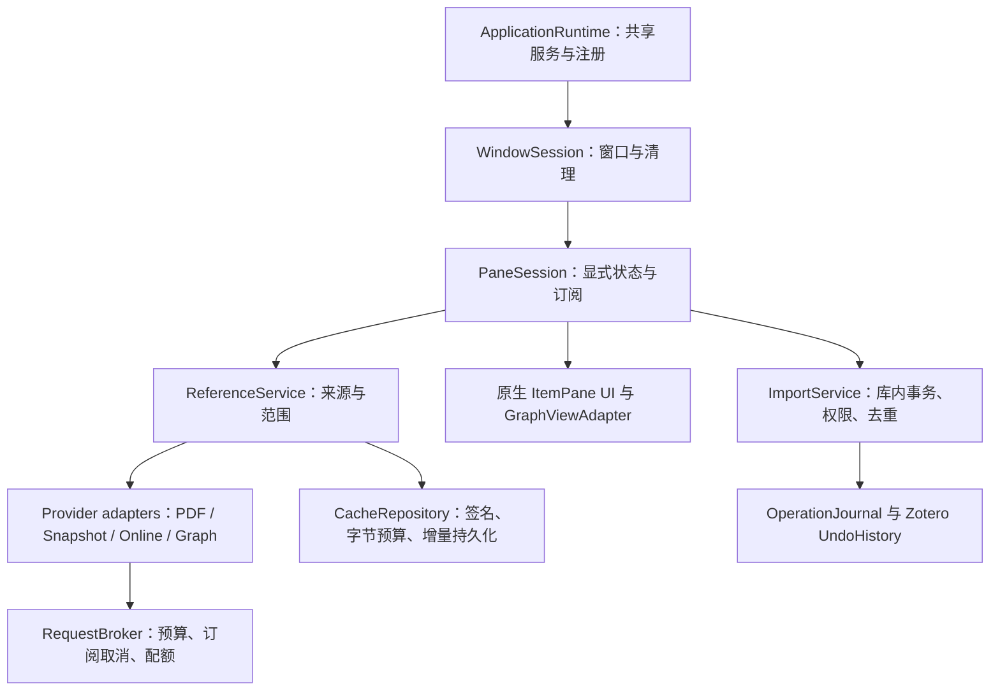

# RefNexus 架构与逻辑全面审查

2026-10-13 补充：数据流专项已进一步完成 Semantic Scholar 官方接口迁移并保留供应方、原生 SDT PDF 提取、Notifier 卡片重查、缓存深拷贝及强制更新代际、hover/CNKI 取消传播。下面的旧 Reader/CNKI 客户端信息/本地匹配缺陷以 [后续数据流报告](DATAFLOW-AUDIT-2026-10-12.md) 为准；其他结构性待办仍需后续实现。

审查日期：2026-10-12。代码位置：本目录上级。实机环境：Windows、Zotero 10.0.6、Firefox 140。结论依据为当前源代码、当前依赖解析和本轮隔离文库验证；旧版本验证仅用来定位工具和测试入口。

## 判断

现有插件已经具备原生 ItemPaneManager 侧栏、Reader 集成、请求去重、取消订阅、来源完整性选择与可回滚导入。问题主要集中在服务与窗口生命周期混用、图谱另走网络与导入路径、DOM 承担业务状态、以及旧类型与旧构建依赖。

本轮完成了可验证的生命周期、请求、缓存、导入和工具链改造。但不能把这些修复称为“已经完全重写为原生架构”。下面明确列出仍需设计和实现的部分。

## 已修复的确定问题

| 问题 | 本轮改动 | 证据 |
|---|---|---|
| 不同窗口同时初始化时，共享 Views 的创建没有同一个 Promise；窗口初始化失败后还会留下成功标记 | 共享服务只初始化一次；每个窗口加载去重，成功后才标记，失败可重试；窗口关闭/停用使未完成初始化失效 | 实机多窗口、重复加载、关闭与重新启用 |
| 窗口关闭后，其参考文献任务和卡片匹配仍可能运行 | 单独 detachWindow，取消该窗口的 pane 任务、释放卡片和样式 | 本轮关闭窗口专项 |
| 共享请求、缓存和 PDF 超时使用动态主窗口的计时器 | bootstrap 导入 Firefox Timer.sys.mjs 和独立 AbortController，全局服务不依赖文库窗口计时器 | 实机 PDF、XHR、停用测试；保留中间失败诊断 |
| 停用只 flush 缓存，没有使缓存对象拒绝后续写入；旧对象注册应用关闭监听器造成重复持有 | 停用执行 dispose；应用退出由 bootstrap 明确保存；取消每个缓存实例的永久关闭监听器 | 旧实例迟到写入拒绝、落盘与启停测试 |
| 已 dispose 的 ReferenceTasks 还能重新启动；取消发生在任务微任务执行前仍会执行工作函数 | 已停止的调度器拒绝新工作，尚未执行且已取消的函数不再调用 | 单元测试、实机旧调度器检查 |
| 出版商/PMC 收到了 signal，却没有把它交给 HTTP；排队的旧请求可能继续占用通道 | HTML、ID 转换、XML 请求传播取消信号，节流等待后再次检查 | 取消真实调度器中的不结束传输；常规出版商实机回归 |
| Auto 模式的“从当前页提取”可能读取全文缓存或覆盖全文缓存；API 路径也缺少范围隔离 | 局部请求不读、不写全文缓存；全文请求继续保留原有缓存 | 实机先全文、再局部、再全文专项 |
| Auto/Web 强制刷新仍可能命中在线内存缓存 | 三种在线模式均清除请求缓存，保留限流冷却 | 常规获取回归 |
| 本地查询开始后发生 Notifier 失效，旧结果仍可重新填回缓存；相同查询并发重复搜索；缓存实际接近 FIFO | 查询按代际失效，相同工作共享 Promise；命中移动到最近使用位置 | 迟到 miss、并发去重单元测试及实机匹配 |
| 图谱 SDK 的 Axios/异步生成器不属于 Zotero 请求生命周期；外层 Promise 超时没有停止内部请求和轮询 | 删除 connectedpapers-js，按官方客户端协议使用 Zotero.HTTP 轮询；取消、退避和总时限统一管理 | 单元取消/超时/轮询；原生嵌入图谱 41 节点验证 |
| 多次构建图谱的旧结果会覆盖新结果，改变来源后还会提交旧结果；失败前先清空旧图谱列表 | 后发构建中止前发构建；提交前检查窗口、信号、来源身份；成功后替换列表 | 图谱传输与原生图谱验证；提交保护的代码审查 |
| 图谱使用低置信 searchItem，且从当前活动窗口推断文库 | 使用经 DOI/标题校验的 searchLibraryItem，明确查询来源文库 | 本地 DOI 冲突回归 |
| 图谱导入使用 forEach(async)，未等待保存就宣布成功，且会导入其他活动文库 | 统一走 BatchImporter，来源文库明确、库内串行、去重、事务保存双向关联；混合文库来源拒绝导入 | 原生两个来源关联导入及回滚；跨库拒绝单元测试 |
| 提示浮层使用全局 document；每次 hover 创建一套 Utils/API/请求缓存 | 浮层持有所属窗口并共享现有服务；卡片定位使用所属窗口 | 第二窗口 hover 专项及原生卡片回归 |
| 已无调用的旧导入函数和 Jasminum 全局 monkey-patch 残留；旧翻译分支修改其他插件的全局中间状态 | 删除无调用路径、SDK 类型和构建替换；翻译只使用独立 translate(text) 接口 | 调用点搜索、类型检查及常规交互回归；第三方翻译服务未实测 |
| CNKI 搜索直接拼接中文/引号/`&` 到 JSON 表单，硬编码 Content-Length，并绕过请求预算 | JSON 序列化和表单编码；支持原始表单 POST，走统一请求客户端并传播取消 | 中文、引号、表单分隔符专项单元测试；CNKI 登录账户未实测 |
| 旧类型包把 Item.get 的 false 返回值等当成其他类型；HTML 标签误用 XUL 类型 | 更新类型包，明确 false/undefined、DOM 元素集合、HTML label 和插件注册边界 | TypeScript 5.9.3 严格检查 |
| 隔离回归会被自动在线更新换包，回环 HTTP 服务未纳入运行准备 | 隔离配置禁止后台更新；独立回环故障服务器验证真实 XHR，补齐测试驱动生命周期空钩子 | 本轮最终实机报告 |

## 剩余问题与重构优先级

以下是当前代码支持的结构性问题和明确限制。潜在后果尚未发生或未测量的，不能当作已经观测到的故障。

| 优先级 | 剩余问题 | 新架构处理方向与验收条件 |
|---|---|---|
| P1 | 状态保存在 DOM 属性、`body.references`、`_cards`、`_setL10nArgs` 中；Views 同时处理来源选择、Reader、缓存、菜单和渲染 | 引入 PaneSession 状态模型：条目、窗口、范围、类型、来源、generation、结果及错误显式建模。UI 只订阅状态。验收快速切换、失效、恢复和停用的状态转移；不允许旧任务修改新 session |
| P1 | 失败与“确实没有参考文献”仍可能都表现为 `undefined` / 空数组；共享 `lastFailure` 可被其他请求覆盖；出版商的 miss 缓存也可能记录临时服务失败 | Provider 返回判别联合：success/empty/partial/unavailable/rateLimited/cancelled，并带来源、错误和范围。只有确认 empty 才写负缓存；失败沿同一请求返回，不能靠共享 lastFailure 推断 |
| P1 | 回滚日志写入父条目 Extra，创建对象、关系、集合和附件各有所有权，但后续编辑和跨批次复用没有完整依赖模型 | 把操作日志迁移到插件自己的持久层。记录可核对的前后状态、批次依赖；保留用户后续修改和后来批次仍使用的对象。接入原生 UndoHistory 管理既有对象修改，同时继续为新建对象提供独立回滚。增加 A 批创建/B 批复用/回滚 A、多次编辑、同步冲突专项 |
| P1 | 图谱 UI 仍是无对应源码构建链的预编译 Vue/D3 文件，通过 `app.$route`、`app.paper_to_color`、内部模拟节点修改宿主；本轮原生嵌入测试只证明现有协议可工作 | 重建可复现图谱前端和明确 GraphViewAdapter。数据获取与布局、展示拆开；用版本化消息传数据；移除对 Vue 内部状态和旧页面方法的依赖。图谱“相似度”与真实“引用关系”必须分开标注，不能称为同一种关系 |
| P2 | 已展示卡片的本地匹配不是完全响应式：Notifier 只清理 Utils 查询缓存；未命中行可能要重新渲染后才发现用户从其他入口添加的条目 | 按文库和条目 ID 增量通知当前 session，仅重新匹配受影响的可见行；合并批量导入的通知，避免每次 save 都整表重绘。验收从 Zotero 原生入口新增、删除、恢复条目后状态自动更新 |
| P2 | JSON 缓存限制条目数但未限制字节数；每次落盘仍序列化整份对象；卡片排序仍重建完整 DOM | 增加字节预算和缓存分层；测量后采用插件独立 SQLite/IndexedDB 的逐记录写入。使用 keyed reconciliation 与列表虚拟化。Worker 只处理纯文本/几何 DTO，不能把 Zotero/Reader/DOM 对象传到 Worker。验收大列表的主线程占用、内存和排序延迟 |
| P2 | 图谱中的许多操作仍是 div、固定白色/浅色样式、英文文案和硬编码选择器；侧栏原生不等于所有图谱操作都原生 | Fluent、本地主题变量、语义 button、键盘焦点与读屏；减少对主窗口内部 DOM 结构的依赖。验证深色、系统高对比、125/150% 缩放、键盘、RTL 与 macOS/Linux |
| P2 | CNKI 账户路径仍依赖旧研学端点与独立 Token 更新逻辑；包含旧客户端信息生成，尚未统一为受控认证适配器 | 把账户能力放入可关闭的 Provider；认证、取消、重试和错误类型统一；优先官方授权接口。需要真实授权账户验证，不把受控表单测试当作服务可用证明 |
| P2 | 多个 service 各有限流器，但没有应用级、按来源的调度/优先级；大任务可排在可见 pane 操作之前 | RequestBroker 按 origin/凭据分队列，可见面板优先，预取可取消；窗口只持有订阅。测试跨窗口共享、配额冷却、前台抢占和队列公平性 |

## 面向 Zotero 的目标架构

Zotero 10 的多集合选择、原生撤销、FTS5、插件闲时维护和本地 API 实例版本是值得对齐的能力。已有 sidepane 与数据对象仍优先使用宿主提供的 API。只有出现实测的大库瓶颈才引入全文索引或独立数据库；不直接复制 WAL 下的主数据库，也不根据未来版本号猜测支持范围。

本轮保留插件 ID、署名、有效数据缓存及最小旧操作日志读取，这些属于用户数据连续性。保留这些边界不要求保留旧网络栈、旧界面或无调用的导入路径。

官方依据：[Zotero 10 开发说明](https://www.zotero.org/support/dev/zotero_10_for_developers)、[Zotero 8 原生菜单说明](https://www.zotero.org/support/dev/zotero_8_for_developers)、[Connected Papers 官方客户端](https://github.com/ConnectedPapers/connectedpapers-js)。未来主版本需要实际测试再更新兼容声明。

## 交付与验证边界

本轮输出为当前源代码、`build/zotero-refnexus.xpi`、本报告和 `evidence/architecture-2026-10-12/`。构建使用 `REFNEXUS_NO_PROMOTE=1`，未替换项目根目录中原有发布 XPI/更新描述，未安装到用户主配置，未推送 GitHub。

最终数量、安装包 SHA-256、依赖审计与脚本体积见同目录的 `verification.json`。主脚本从 563,350 字节减至约 418 KB；这主要反映删除网络 SDK 和新构建器的结果，不能换算为同等比例启动提速。首次启动、长时间运行、内存曲线需要基准测量。

| 最终检查 | 结果 |
|---|---|
| 单元测试 | 165 / 165，通过 |
| Zotero 实机场景 | 原有 109 项 + 新增 6 项，共 115 / 115，通过；不重复计算 16 个套件包装检查 |
| 严格类型检查与生产构建 | 通过；TypeScript 5.9.3 / Zotero types 4.1.3 / esbuild 0.28.2 |
| npm 全部依赖审计 | 0 项告警，含开发依赖；不代表已审计预编译图谱的所有内部代码 |
| 主脚本 | 563,350 → 417,760 字节，减少 25.84% |
| 本地评估 XPI | 226,007 字节；SHA-256 `6c586b322a3154a47b0320a29710f3a1b47ab5b29cfbefca17c3dd85c04fd123` |
| 版本与发布 | 源码版号仍为 11.0.0；本次为评估构建，不是可替换在线更新的正式新版本 |

实机覆盖真实 DOM、PDF.js、SQLite、落盘、AddonManager 启停和回环 XHR；错误与供应方回应用受控输入单独标记。图谱额外验证官方公开 TEST_TOKEN 数据的在线获取，以及该数据在 Zotero 嵌入视图中的轮询和 41 节点渲染。没有使用个人服务凭据。

宿主日志仍有 `uncaught exception: undefined`，其来源尚未定位；另有 Zotero streamer 的外网 WebSocket 连接失败。不能声明启动日志完全干净。OCR/扫描 PDF、CNKI/第三方翻译账户、长期内存、全部插件组合、其他操作系统和未来 Zotero 主版本均未完成验收。

当前子目录确为 Git 仓库，但仍指向上游 `MuiseDestiny/zotero-reference` 的 `bootstrap` 分支，且包含大量本轮前已有未提交修改。只执行只读收尾审查；本轮未提交、标记版本或推送。后续发布应从明确的 `groele/Zotero-diy` 目标检查版本与源码、包装哈希和升级行为，再建立单独发布提交。
