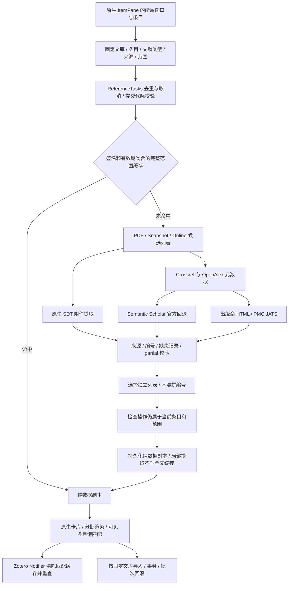

# 数据流、逻辑链条与接口审查

2026-10-13 后续加固：供应方/整条刷新预算、四个补全生产者、字节缓存、认证 POST、Search.resultLevel 与翻译器身份保护已实现。本文末尾对应的旧待办，以 [第二轮链路报告](PIPELINE-HARDENING-2026-10-13.md) 为准；其他架构待办仍保留。

工作开始于 2026-10-12，最终复验完成于 2026-10-13（北京时间）。范围为当前 RefNexus 源码、依赖、生成安装包，以及 Windows / Zotero 10.0.6 / Firefox 140 的隔离原生运行。旧验证记录仅用来定位，不作为本轮验收结果。

## 结论与 Semantic Scholar 保留规则

**Semantic Scholar 保留为正式数据源和独立回退来源。** 已将要求写入 [AGENTS.md](../AGENTS.md) 与 [接口规范](DATAFLOW-AND-API-SPEC.md)，DOI 元数据、标题检索、references、citations 四条链路都在。新增可选 API Key 设置，匿名访问仍保留。

移除的是旧网站内部 `/api/1/`、旧 id_translator、ReadPaper 私有标题查询，以及 PDFViewerApplication / Reader 私有字段读取。Semantic Scholar 能力已迁移到[官方 Academic Graph API](https://api.semanticscholar.org/api-docs/)。Connected Papers 的独立相似性图谱能力仍保留，其 DOI→paperId 改由 Semantic Scholar 官方 DOI 查询提供。

40 个生产源码/资源/构建脚本文件通过 TypeScript AST 扫描，**本轮列出的退役接口命中数为 0**。这不是对一切第三方接口永久有效的保证：SDT 是经当前宿主源码和实机确认的结构化文本服务，图谱内嵌视图仍有内部协议，CNKI 账户接口仍有外部供应方边界。

## 完整逻辑链

| 边界 | 输入与输出 | 当前规则 |
|---|---|---|
| 窗口→业务操作 | 原生 body、所属窗口、parent item | Reader / ZoteroPane 从操作所属窗口取得；不在异步返回时重读全局选择 |
| 操作→协调器 | libraryID、item.key、type、source、range、force | 同一请求合并；不同页码或条目使旧订阅失效；关闭窗口/取消后不提交 UI |
| PDF→原生服务 | PDF attachment ID→SDT reader→catalog/page blocks | 无需打开 Reader；结构版本检查；原生几何转换到双栏文本行，再提取参考文献 |
| 网络→供应方 | 请求服务、signal、官方 DOI / title / cursor | 原生 XHR 取消、并发和队列上限、HTTP 重试与配额冷却；可选 key 只放请求头 |
| 供应方→列表 | 纯 DTO、source、partial、expected/status | 成功空结果与不可用区分；References 用 citedPaper，Citations 用 citingPaper；Related 不冒充引用 |
| 列表→缓存 | signature、savedAt、schema、snapshot | library/item/type/source 隔离；深拷贝；不序列化活的 Zotero.Item；局部 PDF 不读取或覆盖全文缓存 |
| 缓存→卡片 | 纯数据副本→运行时本地关联 | 标题/DOI/来源证据保持独立；库内匹配和撤稿状态在当前卡片代际中更新 |
| 卡片→导入 | 固定 parent/library、选中 DTO | 导入前再查询本地库；图谱与侧栏共用批次事务/来源关联/回滚，不混用不同文库 |

Auto 从 PDF / snapshot / online 的候选链选择结果；Web 从 snapshot / publisher / online 选择；PDF 无可用结果时仍尝试结构化在线来源；API 缺失时可走 PDF 回退。较完整候选作为整份列表替换，来源顺序不拼接。

## 本轮查明并修复的问题

| 问题 | 修复 | 验证 |
|---|---|---|
| DOI→paperId 依赖旧 id_translator；标题元数据另走旧内部站点 | 官方 `/paper/DOI:{encodedDOI}` 和 `/paper/search`；保留四项 Semantic Scholar 能力和回退路径 | 单元 + 原生官方路径受控响应 |
| 标题只取第一条命中，可能指向错误文献 | 多候选核验；相同标题对应冲突 DOI 时不自动选择 | 错误首条候选与同题不同 DOI 测试 |
| 供应方返回的父 DOI 未验证 | Semantic Scholar / OpenAlex 校验 DOI；Crossref 冲突记录被拒绝并允许其他来源回退 | 三供应方身份检查 |
| Semantic Scholar 默认第一页可能只有 100 条 | offset 分页，500 条与 25 秒预算；空/缺失 paper、重复、异常游标、预算截断标为 partial | 两页、方向、缺失、循环游标、数量预算、取消 |
| 图谱列表的顺序可能被误当作论文原文编号 | Semantic Scholar 与 OpenAlex 图谱条目不生成“原文编号”；卡片序号只是当前列表位置 | 提取编号与图谱无编号测试 |
| OpenAlex 无总数时在第一页提前退出 | 无总数继续沿游标读取，完整性不确定则标 partial；重复游标和失败后续页有界退出 | 缺失 total、正常分页、失败后续页 |
| PDF 依赖 `_iframeWindow`、PDFViewerApplication 和 `_readers` | SDT.getReader→catalog→page blocks；Reader 只使用 itemID / getByTabID；附件直接提取 | 五类原生 PDF，Reader.open 调用数为 0 |
| 双栏 PDF 的段落分组与阅读顺序不同，DOI 续行会错位 | SDT textMap 还原实际 glyph 起点/间距，按列重排；保留 Unicode、页归属和编号 | 原生捕获包回放 + 双栏原生 6 条逐项 DOI |
| Auto 当前页可能复用全文缓存，扫描上限结果长久视为完整 | 当前页强制 PDF 范围；任务捕获页码；不读取/覆盖全文缓存；scanLimited 保存并标记，部分缓存 15 分钟有效 | 原生 Auto 全文/局部隔离与缓存专项 |
| 缓存只浅拷贝，运行时作者/标识符可污染缓存 | referenceData 规范化和深拷贝；移除 `_item` / `_itemID` | 嵌套数组/标识符修改与循环 Zotero 对象测试 |
| 强制更新后旧在途请求仍可回写缓存，或新请求合并旧请求 | 请求缓存代际；新代际独立订阅；旧消费者仍能收到旧响应，但不能污染新缓存 | 迟到响应与强制更新竞争测试 |
| Notifier 只清查找缓存，已显示的卡片状态不变化 | 100ms 合并通知；可见卡片重新匹配；匹配代际拒绝迟到结果；保留懒加载 | 原生新增→修改→删除，无额外远程获取 |
| 本地匹配修改标题/标识符，或未知文库回退到个人库 | 查找不改供应方元数据；文库来源不明确则不查；所属窗口与显式 libraryID 优先 | 既有跨库/上下文回归与 DTO 测试 |
| 清洗标点后的标题无法在原生 title 字段中匹配 | 同时查询清洗标题与保留标点的原始标题；候选仍需身份核验 | 原生纯标题、连字符/冒号匹配 |
| 本地撤稿复查未绑定实际 Item，且可能覆盖供应方证据 | 本地匹配完成后检查实际 Item；供应方撤稿证据独立保留，清除本地警示不会擦除它 | 原生本地警示更新与供应方证据保留 |
| hover 停用/关闭后返回元数据，拒绝处理器挂接过晚 | 每个窗口管理当前 tip；tip 清理取消下游；立即挂接拒绝处理器；所属窗口/信号校验 | 关闭第二窗口、停用、共享取消与 hover 回归 |
| CNKI 认证缺少 signal，取消后还可能写 token；每种失败都重新登录 | 信号贯穿认证/详情/参考文献；token 类型检查和迟到写入拒绝；只对明确认证拒绝刷新一次 | 取消认证、未知失败无登录循环 |
| CNKI 拼接未编码文件名、伪造旧客户端信息，第一页冒充完整 | 文件名编码，移除随机 Clientip 和旧 UA；只有 bibliography 能证明完整，首个 refer 页面保守标 partial | 受控参数、首分页标记；无真实账户验收 |
| 工具库仍把未用的旧 Reader helper 带入生产包 | 对 toolkit 6.0.0 的 wait namespace 注册补 pure 注解，使未引用 helper 被正常 tree shaking；库结构变化时构建报错要求重审 | AST 同时扫描源码和最终构建包 |

## 验收与安装包

| 验证 | 最终结果 / 证据 |
|---|---|
| TypeScript / 生产构建 | `npm run build` 通过；`REFNEXUS_NO_PROMOTE=1` |
| 单元测试 | 186 / 186；[unit.log](evidence/dataflow-2026-10-12/unit.log) |
| 原生整包回归 | 109 个独立场景通过；[native-final.json](evidence/dataflow-2026-10-12/native-final.json) 的 16 项汇总检查含内层测试，避免重复计数 |
| 原生数据流专项 | 13 / 13；[native-dataflow.json](evidence/dataflow-2026-10-12/native-dataflow.json) |
| 原生架构专项 | 6 / 6；[native-architecture.json](evidence/dataflow-2026-10-12/native-architecture.json) |
| 退役接口清单 | 40 个生产文件，0 命中；[interface-audit.json](evidence/dataflow-2026-10-12/interface-audit.json) |
| 生产依赖审计 | 0 漏洞；[audit.json](evidence/dataflow-2026-10-12/audit.json) |
| 评估包 | `build/zotero-refnexus.xpi`，227571 bytes；SHA-256 `b3f76a0b15e8ae85c4c809ed9ba2d523ec362ccfa56a23ee5f6ad2b9572efe58` |
| 原根目录包 | 保留；SHA-256 `ba498342a442bb2470dd13ebe231cd41765f9d1375f5a8637cad1ced63aaa3c9` |

本轮共 128 个独立原生场景。实际 PDF 提取、原生 DOM、SQLite、落盘、AddonManager 启停和取消已验证。Semantic Scholar 等外部供应方的故障/分页响应为受控输入；它们证明协议与数据链条，不证明当前在线配额或所有文献都有记录。

五类 PDF 原生提取无需 Reader 标签页；最终单独专项单页耗时约 0.1–0.7 秒，12 页样本约 0.5 秒，以对应 JSON 为准。不是全体论文或大文库的性能基准。SDT 宿主管理生成和缓存，插件仍采用分批渲染、可见条目匹配和全文签名缓存。

中间失败记录保留：最初新增条目自动选择造成测试上下文切换，测试改用宿主 skipSelect；失败后的缓存恢复会创建新 DTO，验证改为检查保留的文献内容与离线状态。并行宿主初始化还发现共享系统临时目录的 translator 文件竞争，测试启动器改为每个进程独立 TEMP/TMP，复验结果另存。没有改动用户主文库或停止其 Zotero 进程。

## 尚不能宣称解决的边界和后续顺序

1. **宿主接口边界。** SDT 按 Zotero 10.0.6 及 schema 1.x 验证，因此最低兼容声明收紧至 10.0.6，保留最大 10.*。不根据未来版本号宣称支持。SDT generation 是宿主共享任务，插件取消能立即释放消费者、拒绝迟到提交，但不能保证物理停止宿主正在生成的全部文本。
2. **公开接口边界。** CNKI 研学账户端点没有本轮可验证的公开授权契约；虽已修正取消/认证/partial，仍须真实授权账户测试。图谱 Vue 预编译资源和窗口 app / GLOBAL_SELECTED_PAPER 等桥接协议需要后续可构建源代码迁移。当前内部协议不等于已退役 Zotero 接口。
3. **更大的结构改造。** DOM body 仍持有列表/类型/来源状态。下一阶段可抽为 ReferenceSession + repository，让 UI 只订阅状态；图谱改为明确 ViewAdapter；引入原生 UndoHistory 前先解决持久批次记录、跨批次关联所有权与恢复。这些工作尚未实施，不将现有回滚称为原生撤销。
4. **性能剩余项。** 缓存目前按条目数控制，缺少统一字节预算；大列表仍创建所有卡片而非完全虚拟化。OpenAlex 邻域的 25 秒循环检查外加单请求预算，整个操作可能超过循环时间一次请求。应用级按来源/凭据/前台优先级调度，以及严格总预算，是下一阶段测量后应集中实现的项目。
5. **验证边界。** 日志仍存在未定位的 `uncaught exception: undefined` 和宿主 streamer 网络失败，不声明日志完全干净。OCR/无文本扫描 PDF、其他操作系统、长期运行内存、全部插件组合、第三方账户、未来 Zotero 主版本尚未验收。

本轮源码版本保留 11.0.0，安装包仅作评估；没有覆盖在线包、创建版本标签、提交或推送。当前 checkout 指向上游 MuiseDestiny/zotero-reference 的 bootstrap 且含大量既有修改；发布前需要明确目标仓库和版本化处理。只读 Git 收尾见 [repo-closeout.json](evidence/dataflow-2026-10-12/repo-closeout.json)。

宿主核对依据：[Zotero 10 开发说明](https://www.zotero.org/support/dev/zotero_10_for_developers)、本机 omni.ja 中的 SDT / PDFWorker / Reader / Item 源码、隔离运行证据。新架构以实际接口契约与可复验数据为依据，不以清空历史代码或升级技术名称本身作为稳定性证明。
