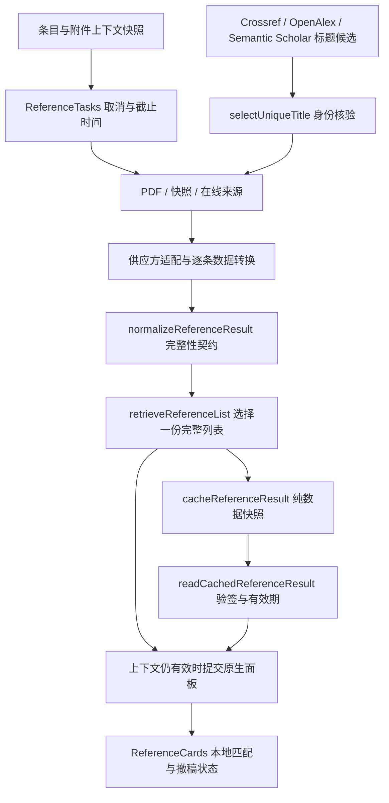

# 逻辑与内容结构专项检验

本轮继续检查标题解析、供应方记录转换、列表选择、缓存恢复与原生界面提交。已落实可复现问题的修复，完成 224 项单元测试与 151 项独立原生场景。验证宿主为 Zotero 10.0.6；供应方响应受控，不能据此宣称所有在线服务或未来宿主已验收。

## 已确认的问题与修复

| 原逻辑问题 | 可能后果 | 当前行为 |
|---|---|---|
| 汇总只检查 partial 布尔值，忽略 status=partial | 提前接受不完整文献表，停止后续来源 | 选择前统一计算完整性；完整候选优先，否则保留最大可用部分列表 |
| 部分查询没有可用记录，最终返回 empty | 将解析损失或截断误报为确认没有参考文献 | 没有可用的部分结果归为 unavailable；与合法空结果分开 |
| 混合编号或仅一条续页编号不触发缺口检查 | 不完整 PDF 被当成全文文献表 | 只要存在原文编号，就核对整个序列是否从 1 连续开始；完全无编号的作者年份表仍合法 |
| 一条坏记录或循环对象导致整批转换异常 | 同批有效文献全部丢失 | 逐条隔离无法转换的行，保留有效记录并标为 partial |
| Crossref/OpenAlex 按首个通过评分的候选返回，三个来源规则不同 | 返回顺序决定 DOI；同标题不同文章错配 | 三个来源共用候选核验与唯一身份选择；冲突 DOI 不自动采纳 |
| 已提供作者/年份时，缺失候选字段仍可能获得足够总分 | 精确标题掩盖佐证不足 | 已提供的作者与有效年份必须获得对应佐证；年份允许相邻年份 |
| resolveWork 只尝试两个来源，前一来源异常直接中断 | Semantic Scholar 已实现却无法参与统一 DOI 解析 | 按 Crossref → OpenAlex → Semantic Scholar 回退；单来源故障可继续，取消后不提交结果 |
| 缓存恢复手工展开 snapshot，缓存畸形对象可能直接抛错 | 完整性丢失、来源变为 undefined、刷新失败 | 保存/恢复同一结果契约；畸形缓存按未命中处理；统一部分结果 TTL 与离线回用 |
| OpenAlex 按原始行数判断达到总数，嵌套作者数组缺少形状检查 | 重复行使翻页提前结束；一条坏行破坏整页 | 按验证后唯一记录计数；集中转换字段，坏行隔离并标记截断 |
| 缺失 related_works 被转为空数组 | 缺失元数据误报为确认没有相关文献 | 明确返回元数据不可用，保留已有界面结果的回退路径 |

标题自动匹配仍是启发式判断：统一规则只对供应方返回的候选集核验唯一性，不等于全数据库唯一性。较长标题完全相同时可以在未提供作者/年份的情况下采纳唯一候选；提供了佐证字段时不能忽略它们。短标题继续需要评分佐证。重复 DOI 归一化后视为同一身份，来源 ID 可用于识别缺失 DOI 的重复行。

## 结构调整

模块职责收敛为：

| 模块 | 本轮集中负责的逻辑 |
|---|---|
| titleResolution.ts | 与供应方无关的标题、作者、年份核验及唯一身份选择 |
| semanticScholar.ts / openalex.ts / api.ts | 各来源字段适配、官方请求及回退；OpenAlex 摘要转换在三个入口复用 |
| referenceData.ts | 自有纯数据副本、运行时对象排除与单行校验 |
| referenceRetrieval.ts | 完整性计算、取消检查及整份候选列表选择 |
| referenceCache.ts | 结果快照保存、恢复、有效期及离线列表回用 |
| views.ts | 保留上下文保护、界面提交与用户状态；移出重复缓存拼装，统一结果描述 |

线上检索策略签名由 retrieval-v4 升到 retrieval-v5，避免继续读取旧身份选择规则下的缓存；PDF 提取策略仍为 pdf-sdt-v2。本轮没有删除 Semantic Scholar 的 DOI、标题、references 或 citations 能力，进一步接通了其统一解析器回退。

已补充[数据流与接口规范](DATAFLOW-AND-API-SPEC.md)第 13–15 条。官方来源依据为 [Semantic Scholar Graph API](https://api.semanticscholar.org/api-docs/) 和 [Zotero 10 开发说明](https://www.zotero.org/support/dev/zotero_10_for_developers)。采用现有原生 ItemPaneManager、Reader、SDT、Search、事务与宿主原子写入；本轮没有引入新的宿主接口或外部运行时。

## 验证与产物

| 检查 | 结果与证据 |
|---|---|
| 单元测试 | 224/224，其中新增专项 18 项；[日志](evidence/structure-2026-10-13/unit.log) |
| 原生综合回归 | 109 项独立场景；外层 16 项包含 7 组内层场景，不重复计数 |
| 原生数据流 / 架构 / 预算与持久化 | 分别 13、6、15 项 |
| 原生结构专项 | 8/8，覆盖三个来源的歧义、S2 标题回退、异常回退、真实 SDT 替换部分索引列表、坏行与缓存、旧策略失效、去重分页、畸形邻接数据 |
| 原生合计 | 151/151，全部隔离配置、文库及 TEMP/TMP；[汇总](evidence/structure-2026-10-13/verification.json) |
| 类型与生产构建 | 通过；[类型日志](evidence/structure-2026-10-13/tsc.log)、[构建日志](evidence/structure-2026-10-13/build.log) |
| 退役接口扫描 | 43 个生产源码/构建文件，指定退役成员与旧网址命中 0；[AST 记录](evidence/structure-2026-10-13/interface-audit.json) |

评估包 build/zotero-refnexus.xpi 为 231120 字节，SHA-256：`6e2e27d9ee785494e40a922dcb969d320392eb84d783613bb1c02d5cc795333d`。源码版本保持 11.0.0。原根目录 XPI 与 update.json 哈希未变，无提交、标签、发布或推送。

已有修改按本轮开始时的备份保留；[变更清单](evidence/structure-2026-10-13/changes.json)与 diffs 子目录以该备份为基线，不把此前脏工作树计入本轮修改。另有 typing/global.d.ts 的 checked 可选字段声明，以及本报告和规范条款更新。[只读收尾](evidence/structure-2026-10-13/repo-closeout.json)仍确认当前 checkout 指向上游 bootstrap。

## 尚未完成的架构事项

| 优先级 | 剩余事项 | 实施边界 |
|---|---|---|
| P1 | 未定位的宿主 uncaught exception: undefined | 仍出现于隔离运行日志；专项断言通过不能证明这条异常已消除，需独立追踪触发栈 |
| P1 | 跨批次导入关联所有权、完整导入取消与预算 | 先确定关系增删与迟到附件的归属，再接原生 Undo；创建对象不能直接包装为完整宿主 Undo |
| P2 | Views 的检索 session 仍有状态保存在 DOM | 本轮只集中结果/缓存契约；后续抽出独立 session 与 repository，同时保持窗口/附件快照保护 |
| P2 | 图谱预编译 Vue 内部桥接、列表虚拟化 | 仍依赖当前内部实现；先明确输入/输出事件，再逐步替换，不能将相似图谱冒充引文关系 |
| P2 | 多服务统一请求调度与增量持久化 | 已有有界队列与字节预算；统一前台优先级、凭据限流与持久化调度尚未实现 |

未来宿主、长期内存、OCR、完整插件组合和各付费/认证账户未验收。宿主 streamer 网络失败仍留在原生日志。零退役接口命中是指定扫描范围的结果，不等于全部调用都属于公开稳定 API，也不等于零逻辑缺陷。
