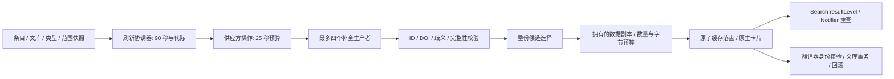

# 数据处理链路第二轮加固

日期：2026-10-13（北京时间）。环境：Windows / Zotero 10.0.6 / Firefox 140。继续检查获取、元数据补全、候选列表选择、缓存、本地查找、渲染及导入/回滚。前一轮结果见 [数据流审查](DATAFLOW-AUDIT-2026-10-12.md)；本轮没有取消 Semantic Scholar 的任何正式能力。

## 本轮实际修复

| 链路与缺陷 | 实现 | 结果与边界 |
|---|---|---|
| OpenAlex 的 25 秒检查从父记录查完后才开始，不能限制当前页或补全等待 | OperationBudget 覆盖父查询、队列、补全、全部分页；Semantic Scholar 使用同一预算机制 | 一个供应方操作默认 25 秒；耗尽后不再启动后续页，已有页保留为 partial。计时器使用独立 Firefox 全局，不依赖主窗口 |
| 下游不响应取消时，ReferenceTasks 返回的 Promise 仍可能一直等待 | 整条刷新链默认 90 秒；取消/超时立即结算协调器；提交检查包含 deadline 和代际 | 超时解除 busy/按钮状态、保留卡片、拒绝迟到结果。该预算针对刷新，导入/回滚仍在独立事务队列中 |
| 一个预算超时可能错误中断其他共享订阅 | 预算只取消自己的订阅；最后一个消费者退出时才取消原生 XHR | 实际回环 XHR 验证：短预算退出，另一订阅正常收到结果；只有一个传输且没有被误取消 |
| OpenAlex 补全为每个 chunk 立即创建 Promise，长列表会占满队列 | 最多四个生产者，逐个领取 100-ID chunk，整个补全共用 deadline | 1000 ID 为 10 次请求，峰值四个并发；预算耗尽不再生产新请求 |
| 补全响应的 ID 未与请求清单核验，可能夹带无关作品 | 规范化 W ID，只保留请求内作品、有效标题和首个同 ID 结果；保留请求顺序 | 受控响应注入额外 W99999，被排除；没有把未知 ID 当作新引用 |
| Crossref 有少量引用时，不会继续尝试 Semantic Scholar | 显著缺失时用 5 秒可选补全预算比较 Semantic Scholar 的整份候选 | 更完整候选整份替换；不拼接编号、不混来源顺序；完整主列表不增加这次请求 |
| 参考文献逐项线性扫描所有 OpenAlex 结果，且同题不同 DOI 可能取第一条 | 建 DOI / 标题索引；身份唯一才补全；模糊候选仍须核验；限制过大的模糊笛卡尔比较 | 精确 DOI 路径由平方级比较改为建索引加查询；有歧义时保留原始引用，不任意补 DOI |
| Semantic Scholar 不同 paperId 可能代表同 DOI；缺失所有 citedPaper 还可能被当作合法空表 | 按 paperId / DOI 别名去重；缺失、重复和不确定结果保留 partial | 同题但不同 DOI 不合并；不能用解析损失证明“无引用” |
| HTTP 与持久缓存只按条数限制，少量大载荷可使缓存膨胀 | 同时限制数量与 UTF-8 序列化字节；默认每个存储 8 MiB、单项 2 MiB；LRU 和容量统计 | 超大结果仍可展示，但不驻留缓存；持久缓存拒绝超大初始文件；这不是整个进程的堆内存上限 |
| 缓存响应和共享响应的嵌套对象仍可被消费者修改 | 编码成拥有的缓存快照；读取、共享响应分别返回数据副本；内部持久缓存不直接暴露可变对象 | 两个消费者相互隔离；缓存不会被作者/标识符数组的运行时改动污染；移除活的 `_item` / `_itemID` |
| 未提供 libraryID 的缓存操作仍猜测为个人文库 | 缺少明确文库则不读写；缓存读入验证 library:item 命名空间 | 真实 Zotero.Item 正常使用；无文库 DTO 不再静默归入 library 1 |
| 缓存写入失败或新结果过大后，旧缓存可能继续误导后续读取 | 写失败保留 dirty，可重试最新快照；过大/不可序列化更新使相应旧键失效 | 使用宿主原子文件写入，不另写一套数据库；串行落盘，重试写入最新状态 |
| CNKI 登录 POST 被缓存，认证刷新可能重复拿到旧 token | 登录显式 cache:false；可缓存搜索 POST 保持原有行为；token 头纳入配额隔离 | 受控认证两次得到不同 token，缓存条数为零；真实账户服务仍未验收 |
| 查找先返回混合层级结果，再加载大量子条目后筛选 | 使用 Zotero 10 `Search.addCondition('resultLevel','item')` | 宿主 SQL 先排除子附件/笔记/注释；仍验证常规文献类型、文库和 DOI；保留标点标题匹配 |
| PDF 在扫描上限内见到“References”续页，就可能错误标记为完整 | 分别记录“见到标题”和“找到文献表起点” | 起点为 51 的续页仍为 scanLimited；局部/不完整结果不会变成永久完整缓存 |
| 原生 DOI 翻译器返回其他文献时，只强制改回 DOI，标题作者仍错误 | 拒绝冲突翻译器元数据，回退当前引用；写入规范化 DOI；阻止将文献 DTO 创建成笔记/附件/注释 | 原生创建、标题/DOI/类型及批次回滚均验证；翻译器继续 libraryID:false，迟到元数据不自行写库 |
| 同一父条目的两个 PDF 共用任务键；条目信息在请求途中修改后仍可能提交旧结果 | 请求身份加入文档 ID、DOI/标题/URL/日期/作者快照；提交前重新核验；显式 parent 与面板绑定不符时拒绝 | 不同 PDF 不再被合并；旧文档迟到响应和编辑前响应均被拒绝；上下文变化解除 busy 并提示刷新 |
| CNKI 主题搜索首条未经原文核验，详情页依赖 childNodes[1]，下载统计缺失时显示 0 | 校验实际详情标题后才使用自动查询的 fileName；改用 documentElement；缺失统计保持未知 | 无 DOCTYPE 的原生 DOM 测试通过；不相关首条被拒绝；真实账户与网站长期变化仍需验收 |

## 更新后的约束

取消分三层：协调器先释放等待与 UI；供应方预算停止分页和排队；请求服务在最后一个订阅离开时取消原生传输。已提交卡片的本地匹配生命周期独立于抓取任务，仍能继续懒加载。本轮没有用 timeout race 假装停止宿主共享 PDF 生成，也没有让未完成的附件导入在回滚队列之外运行。

缓存文件仍为插件自己的 `refnexus-v2.json`，内部引用 schema 保持 3。没有读取或直接修改 Zotero 主数据库文件；维持原生数据对象、Search 和 DB 事务。确认本机 `Zotero.File.putContentsAsync` 已通过临时文件原子替换，所以不引入第二套写入协议。

检索签名更新为 retrieval-v4，PDF 提取签名更新为 pdf-sdt-v2。旧策略可能生成错误标题关联或错误完整性标记的缓存不会直接沿用；按需重新获取，原始 Zotero 数据保持不变。

## 实机证据与性能

本轮 [verification.json](evidence/pipeline-2026-10-13/verification.json) 汇总最终证据；供应方内容为受控响应，PDF / DOM / SQLite / 缓存文件 / 回环 XHR 为真实原生运行。

| 验证 | 结果 |
|---|---|
| TypeScript 与生产构建 | `npm run build` 通过；禁止 promote |
| 单元测试 | 206 / 206，包括预算、缓存、生产者、身份、续页及写入重试 |
| 原生整包回归 | 109 个独立场景，16 个外层汇总项 |
| 原生数据流 / 架构 / 新链路专项 | 13 / 6 / 15，合计本轮 143 个独立原生场景 |
| 退役接口扫描 | 42 个生产源码/资源/构建脚本文件，列明的旧接口 0 命中 |
| 生产依赖审计 | 0 漏洞 |
| 评估 XPI | 230387 bytes；SHA-256 `4f2f8acb6519fbfd41ad2651819eb5afb6b62bd8ec9350c58831c72def325d28` |

新专项测量包括 1000 ID 补全、2000 DOI 精确关联、预算取消和字节缓存恢复，具体耗时见 [native-pipeline.json](evidence/pipeline-2026-10-13/native-pipeline.json)。2000 项精确关联在隔离实机受控数据中为几十毫秒量级；这只是算法路径测量，不能宣称所有网络服务或大库都有同样速度。1000 卡片仍分批让出事件循环，缓存命中不重新打开 Reader。

新专项首次失败来自测试 instrumentation 替换了 `Zotero.Search` 构造器，破坏宿主 `_super`，不是产品检索故障。改为观察原生 prototype 的方法，并在 finally 恢复；保留 [首次记录](evidence/pipeline-2026-10-13/native-pipeline-first.json)。所有写入在独立配置、文库和 TEMP/TMP 内完成，用户主文库不参与。

上下文保护还揭示旧 major-suite 的本地匹配夹具会自动选中新条目，却向旧 parent 刷新。生产保护拒绝该调用；夹具改用宿主 skipSelect 固定上下文，验证其本来要检验的“提交后懒匹配”。失败过程保存在 `native-final-first-context.json` 与 `native-final-native-major-context-first.json`。

## 面向后续 Zotero 版本的判断

本轮采用或继续使用原生 ItemPaneManager、Reader.itemID/getByTabID、SDT、Search.resultLevel、数据对象/事务和宿主原子写入；依据为[Zotero 10 官方开发说明](https://www.zotero.org/support/dev/zotero_10_for_developers)与本机源码及实机验证。保持能力适配边界与 schema 检查，不根据未来版本号猜测 API。

仍须后续处理：

- 多服务已有各自队列，本轮减少批量生产压力，但尚未实现统一的来源/凭据/前台优先级 RequestBroker。
- 主界面仍由 DOM 保存部分 session 状态；图谱预编译 Vue 的内部桥接、真正的列表虚拟化和增量缓存持久化尚未改造。
- 原生 UndoHistory 支持已有对象修改，不能撤销创建；不能把现有批次回滚直接包装为完整原生 Undo。跨批次关联所有权需先完善。
- 批量导入仍按文库串行、每条翻译器有超时、附件下载完成后再结束批次；尚无完整导入取消 UI/总预算。后续不能简单 race 原生附件导入，否则会制造回滚后的迟到附件。
- 实机最低版本保持 10.0.6。未来宿主、长期内存、OCR、全部插件组合、CNKI/其他账户均未完成验收。部分宿主日志仍有未定位的 `uncaught exception: undefined` 和 streamer 网络失败。

源码版本保持 11.0.0，仅更新 build 下评估包；原根目录发布包和 update.json 哈希均保留。当前 Git 指向上游 bootstrap，含大量此前修改，只有 [只读收尾](evidence/pipeline-2026-10-13/repo-closeout.json)，没有提交、标签、发布或推送。
